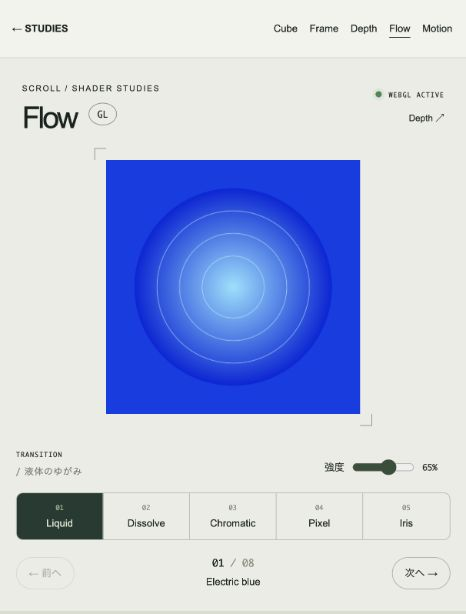

# Theme Studies

Next.js / React / JavaScriptで作った5つのインタラクティブなテーマです。表示構造・操作処理・CSS・投稿データを分離しています。

**[TypeScript版](./typescript/README.md)** も `typescript/` に収録しています。5テーマを維持した独立アプリで、`strict` モードの型チェックに対応します。JavaScript版はこのリポジトリ直下です。

## 公開サイト

- [JavaScript版](https://rulers.github.io/theme-studies/)
- [TypeScript版](https://rulers.github.io/theme-studies/typescript/)
- Flow: [JavaScript](https://rulers.github.io/theme-studies/themes/move-v2/) / [TypeScript](https://rulers.github.io/theme-studies/typescript/themes/move-v2/)

トップページから両版を切り替えられます。`main`へのpushで両版を検証・静的書き出しし、成功した成果物をまとめてGitHub Pagesへ公開します。pull requestでは検証のみ実行します。

| テーマ | 内容 | URL |
| --- | --- | --- |
| Cube | 写真を6面に映す回転する立方体 | `/themes/cube` |
| Frame | 全画面投稿と表示オプション | `/themes/focus300` |
| Depth | スクロールで奥行きを移動 | `/themes/move` |
| Flow | 5種類のWebGLトランジションと強度調整 | `/themes/move-v2` |
| Motion | 背景動画と2列の投稿 | `/themes/video` |

FlowはLiquid / Dissolve / Chromatic / Pixel / Irisに対応。スクロールで進行し、逆スクロールで巻き戻せます。[操作・実装・検証結果](./docs/OKMOVE-V2.md)



## 起動

Node.js 22以降を使用します。

```sh
npm ci
npm run dev
```

http://localhost:3000 を開きます。確認は `npm test` と `npm run build`、本番モードはビルド後 `npm start`。

## 開発チェック

両版にESLint（Next.js / React Hooks）とPrettierを導入しています。TypeScript版ではTypeScript用ルールとstrict型チェックも実行します。

| コマンド | 内容 |
| --- | --- |
| `npm run lint` | 警告も含めてESLint違反を検出 |
| `npm run lint:fix` | 自動修正できるlint違反を修正 |
| `npm run format` | ソース・CSS・設定ファイルを整形 |
| `npm run format:check` | 整形済みか確認 |
| `npm run check` | lint・整形・テストを一括確認（TS版は型チェックも含む） |
| `npm run build` | 本番ビルド |

GitHub Actionsではpush / pull request時に両版の `npm ci` → `npm run check` → `npm run build` を実行します。生成ファイルと調査用の `reference/` はlint対象外です。CMS画像は固有の縦横比とSVGを扱うため、共通投稿表示の1箇所のみネイティブの`img`を使用し、理由付きでNext.jsの画像最適化ルールを除外しています。

Pagesビルドは `STATIC_EXPORT=1` と `NEXT_PUBLIC_BASE_PATH` を指定し、`out/`へ書き出します。CIでは `scripts/check-export.mjs` で6ページと参照アセットの実在・パス接頭辞を検証します。通常のローカル開発では環境変数の指定は不要です。公開を戻す場合は対象コミットをrevertして`main`へpushします。

TypeScriptはlintパーサーの対応範囲に合わせて6.0系を使用します。ESLint自体は10系です。

依存関係の確認（2026-10-17）: 両版とも `npm ci` は成功し、`npm audit --omit=dev` は0件です。開発依存にはNext.jsのlintプラグインから `braces` に至る依存チェーンでhighが5件報告されます。同じ原因の依存先を含む件数で、[上流の修正版は未提供](https://github.com/advisories/GHSA-vfj7-8cjw-p6xm)です。また、一部プラグインのpeer宣言がESLint 10に追いついていないため、インストール時にpeer警告が出ます。両版のlint実行は警告・エラー0件で確認しています。

## 分離した構成

| 場所 | 役割 |
| --- | --- |
| `app/page.jsx` | 5テーマへの入口 |
| `app/themes/[theme]/page.jsx` | サーバーで投稿データ取得・テーマ選択 |
| `components/*.jsx` | HTMLに相当するJSX構造とイベントの接続 |
| `hooks/*.js` | スクロール・状態・追加表示などのJavaScript処理 |
| `app/globals.css` | レイアウト、3D変換、アニメーション |
| `lib/posts.js` | サーバー側の投稿データ取得口 |
| `lib/video.js` | YouTube / Vimeo URLの検証・変換 |

Reactでは別HTMLをDOMに挿入する方式を使わず、JSXで表示構造を記述します。処理本体はフックへ分離し、コンポーネントには表示とイベントの接続だけを置いています。`window`や`document`はイベントまたはEffect内だけで使用し、SSR時には実行しません。

## 元コードとの対応

| 元テーマ | URL | 実装した内容 |
| --- | --- | --- |
| `cubetheme.html` | `/themes/cube` | 写真を6面に表示、36秒のCSS回転、停止・再開 |
| `okfocus300.html` | `/themes/focus300` | 全画面投稿、次投稿へ移動、配色反転、文字非表示、画像拡大、追加表示 |
| `okmove.html` | `/themes/move` | 投稿を1000px間隔で配置、スクロール追従と補間、前後移動、現在投稿の表示 |
| `okvideo.html` | `/themes/video` | 背景動画、2列投稿、追加表示、タグ |

`lib/posts.js`のサンプル8件で動きます。追加表示は有限配列を3件ずつ表示するデモで、Tumblrへの通信ではありません。Depth / Flowは全件を最初に配置します。サンプル画像は同梱のSVGで、外部画像サービスは使いません。

## 自分のデータで使用する

`getPosts()`をCMSやTumblr APIからの取得処理に置き換え、`id`, `type`, `title`, `image`, `alt`, `caption`, `tags`等へ正規化します。非同期化した場合はページの `getPosts()` を `await getPosts()` に変更します。APIキーはサーバー側の環境変数に保持してください。

共通表示は `photo`, `text`, `quote`, `link`, `video`, `audio` に対応します。`video` / `audio` の `url` は直接再生できるメディアURL用です。Photosetは写真ごとに展開してください。Chat / Answerは現状専用表示未実装です。文字列はプレーンテキストとして描画し、TumblrのHTML本文・埋め込みHTMLをそのまま挿入しません。

背景動画は `VideoTheme` の `source` propでYouTube / VimeoのHTTPS URLを指定できます。初期表示は静止背景で、再生ボタンを押すと外部iframeを読み込みます。停止時はiframeを破棄します。動画の公開設定、ネットワーク、ブラウザの自動再生制限により再生できない場合があります。

## 実装対象外

Tumblrの実投稿取得、検索、個別投稿ページ、実APIページング、Like / Reblog / Notes、Twitter、Disqus、Analytics、管理画面設定は接続していません。実サイトの完全一致を必要とする場合は、対象テーマと投稿データを決めて個別に詰める必要があります。

## ライセンスと出典

Theme Studiesで作成したコード・アセットは [MIT License](./LICENSE) です。

[okfocus/tumblr](https://github.com/okfocus/tumblr) の4テーマを研究し、主要な表現・操作をNext.js向けに再構成しています。元のHTML・外部スクリプト・CSSの参考コピーは公開リポジトリに含めていません。原作や依存ライブラリをMITへ変更するものではありません。詳細は [NOTICE.md](./NOTICE.md) を参照してください。

調査の詳細は [ANALYSIS.md](./ANALYSIS.md) を参照。
