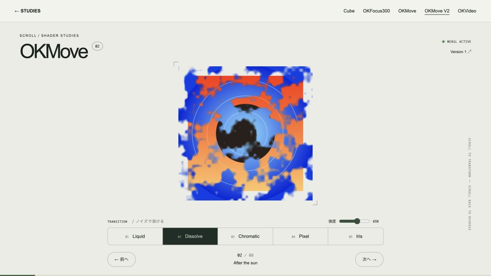
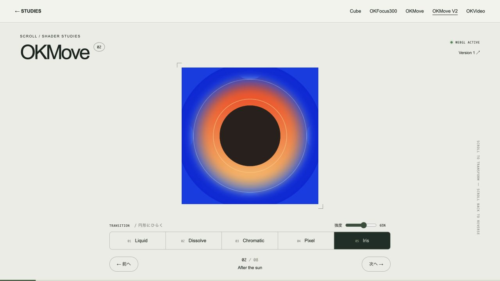

# Flow — WebGL transitions

URL: `/themes/move-v2`。入口の「Flow」またはDepthの「Flow / WebGL」から開けます。旧名はOKMove V2です。

## 操作

- スクロールで次の投稿へ進み、逆スクロールでトランジションを巻き戻します。
- 画面下の5つのボタンでパターンを変更。同じスクロール位置のまま比較できます。
- 強度スライダーで効果を調整できます。
- 「前へ」「次へ」で投稿単位に移動します。

| パターン | 表現 |
| --- | --- |
| Liquid | 波状のUV変位で液体のようにゆがむ |
| Dissolve | 多段のノイズをマスクにして溶ける |
| Chromatic | 横方向のスライスとRGBチャンネルのずれ |
| Pixel | 中間で粗くなり、次の画像へ解像する |
| Iris | 中央から円形に開き、縁に波紋が走る |

## 構成

- `components/MoveV2Theme.jsx`: JSXと操作UI。
- `components/move-v2.css`: V2専用のレイアウト。
- `hooks/useDepthScroll.js`: V1 / V2共通のスクロール。1投稿あたり1画面、追従の補間係数1/9、最寄りの投稿へ前後移動。V2には連続した投稿位置をコールバックで渡します。
- `hooks/useWebGLTransition.js`: テクスチャ準備・リサイズ・モード変更・コンテキスト喪失と復旧・終了処理。
- `lib/webgl-transition.js`: WebGLのバッファ、uniform、テクスチャ、描画とリソース解放。
- `lib/move-transitions.js`: GLSLとスクロール位置から描画ペアを決める純粋関数。
- `lib/post-texture.js`: 写真と文字投稿を768pxの正方形テクスチャへ変換。

Three.js等の依存は追加せず、ブラウザ標準のWebGL 1を使います。スクロール位置の小数部が切替進行度になるため、時間ベースの再生待ちはなく、逆方向も同じフレームを辿ります。元のCSS 3D配置はV1に残し、V2の奥行き感はシェーダー内のズームとトランジションで表現しています。

停止中は常時アニメーションを回しません。スクロール追従・パターン/強度変更・リサイズ・テクスチャ準備完了時に描画します。描画解像度はdevicePixelRatio 1.5までに制限しています。

## フォールバックとデータ

WebGLが使えない場合・初期化失敗・コンテキスト喪失時は現在の投稿をHTMLで表示します。OSの「視差効果を減らす」等に対応する `prefers-reduced-motion: reduce` が有効な場合もHTML表示に切り替えます。GPUリソースとイベントはページ離脱時に解放します。

写真・テキスト・引用・リンクを同じシェーダーで遷移できます。リンクの操作はcanvas外の通常のアンカーから行います。動画・音声の再生面をWebGLテクスチャにする機能は含めていません。外部画像へ差し替える場合は配信元のCORS許可が必要で、画像読込に失敗した場合はHTML表示へ戻します。

参考: [MDN: Using textures in WebGL](https://developer.mozilla.org/en-US/docs/Web/API/WebGL_API/Tutorial/Using_textures_in_WebGL)

## 検証

2026-10-17: 6件のNodeテスト成功・Next.js本番ビルド成功。実ブラウザで `WEBGL ACTIVE` を確認し、5パターンの途中フレーム、強度変更、逆スクロール、前後ボタン、写真と引用投稿の描画を確認。375×812、320×568、844×390でもレイアウトを確認しています。

WebGL非対応端末・GPUコンテキスト喪失の強制再現・OSの動作軽減設定は実機テスト未実施です。

